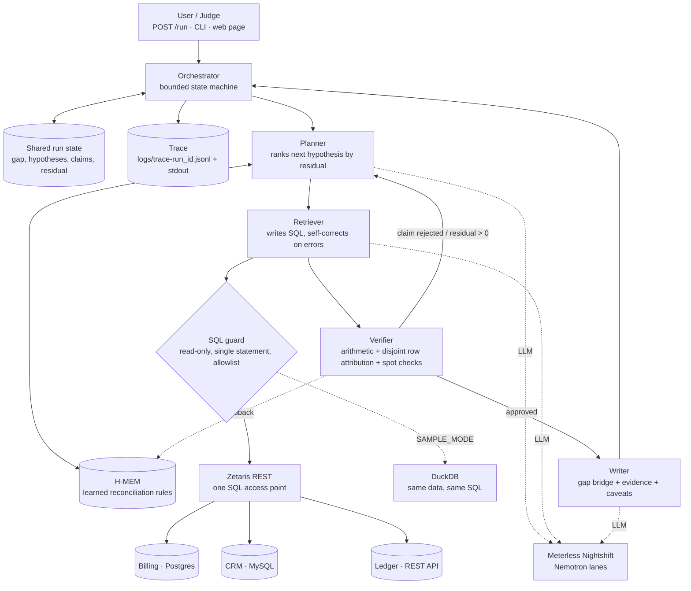

# GapZero — Plan

> **Status:** draft, awaiting Shameer's approval (builder check done; decisions marked "Max's call") · last updated 2026-10-20 (UTC)
> **Event:** Open Agent Hackathon 2026 · build window 22 Oct 00:00 → **27 Oct 23:45 UTC** (hard deadline)
> **Track:** The Agent That Can Explain Why · **Team:** solo (Shameer + AI pair "Max")
> **Repo:** `devinwarp/gapzero` (public) · task tracking in [TODO.md](TODO.md) · lessons in [LEARNINGS.md](LEARNINGS.md)

---

## 1. Intent

**One sentence:** GapZero is an agent that answers *"why don't our numbers match?"* across billing, CRM and the finance ledger, and keeps going until every dollar of the gap is explained by named records.

**The user:** whoever has to explain the gap, usually a RevOps or finance lead an hour before a board or QBR meeting. The board deck says $4.5M, billing says $4.2M, the ledger says $4.1M. Today that takes days of exports, VLOOKUPs and Slack threads.

**The output:** a gap bridge (waterfall chart) from source A's total to source B's total. Each bar is a cause, such as a timezone cutoff, refunds not posted, duplicate deals or FX rounding. Each bar comes with the dollar amount, the exact record IDs, the confidence and the query that proves it. Anything not yet explained is shown honestly as a grey **residual**.

**Why it wins (mapped to the rubric):**

| Criterion | Pts | How GapZero earns it |
|---|---:|---|
| Impact | 30 | A universal, painful, recurring problem; a named user; output they can paste into a deck |
| Technical | 20 | Non-linear multi-agent loop; arithmetic verification; retries; bounded runs; Docker; sample mode |
| Innovation | 15 | The Verifier uses **maths, not vibes**: claims are rejected unless the attributed records reconcile |
| Demo | 15 | The waterfall fills in bar by bar, the trace shows a rejected claim, and the residual reaches $0 |
| Product & UX | 10 | The waterfall is the chart finance teams already use for this problem |
| Sponsor Tech | 10 | Zetaris federates three heterogeneous sources; Nemotron through Nightshift; H-MEM learns rules |

## 2. Goals, non-goals, anti-goals

**Goals**
- Explain a numeric gap between any two of the three sources, for any period, region or segment a user asks about.
- Every explained dollar is attributed to specific record IDs, and no record counts toward two causes.
- Learned rules persist across sessions (H-MEM) and transfer to new periods and regions.
- A judge can run it with **no credentials** (`SAMPLE_MODE=true`) and get a real investigation.
- Every requirement in the hackathon docs is met (see TODO.md, "Submission deliverables").

**Non-goals**
- Real connectors to Stripe, Salesforce or NetSuite. The sources are realistic simulations.
- Auth, multi-user support, long-term hosting, or month-end close workflow tooling.
- Writing fixes back into source systems. GapZero is read-only by design.

**Anti-goals** (failure even if it "works")
- Any hardcoded answer, canned trace, or code path that knows the fault list. The agents must never see the simulator's ground truth.
- Explanations that add up only because errors cancel or records are double-counted.
- Zetaris or Meterless present in name only.
- A run that hangs: every loop is capped and every call has a timeout.

## 3. Constraints (from the hackathon docs and recon)

- **Required:** Zetaris integrated; Meterless Nightshift as the primary AI provider; **at least one Meterless Engine** in a working feature with its conformance suite passing; built in **Cursor** (Claude Code used alongside, disclosed).
- **Optional but targeted:** NVIDIA Nemotron through Nightshift (counts toward Sponsor Tech, and qualifies for the DGX Spark award).
- **Pre-existing work:** the planning docs in this repo were written before the window and are declared. No product code is committed before 22 Oct 00:00 UTC.
- **Runs on a judge's ordinary machine:** no local GPU, minutes per run, Docker, programmatic `POST /run`.
- **Zetaris realities** (see LEARNINGS.md): file tables need S3 plus a real AWS key, so we use a JDBC datasource and a REST table instead. One SQL statement per call. Some DDL isn't idempotent.
- **Machine:** M4 Pro, 24 GB RAM. Docker currently has 7.75 GiB, so raise it to 10 GB. Use Nightshift's free M1+ edition.

## 4. Architecture



### Agents (distinct roles, real authority)

| Agent | Responsibility | Can block / retry? | Model lane |
|---|---|---|---|
| **Planner** | Measures the gap, picks the next hypothesis by expected residual reduction, recalls rules from H-MEM first | Revises its plan on Verifier feedback | deep |
| **Retriever** | Turns a hypothesis into SQL over the three sources; on an SQL error, feeds the error back and rewrites the query (max 3 tries) | Retries, narrows or broadens; falls back to sample data | fast |
| **Verifier** | Runs its **own** queries. A claim passes only if the attributed record IDs sum to the claimed amount, are disjoint from other approved claims, and pass a spot-check of n sample records | **Blocks** claims, sends the Planner back | none for the maths; deep only for the spot-check rationale |
| **Writer** | Builds the bridge, evidence table, caveats and next actions. Cannot start until the Verifier approves or the run escalates | Reviewer loop is a stretch goal | fast |

**Termination:** the residual is within tolerance (default $1), **or** the iteration cap is reached, **or** the time budget runs out. Hitting a cap ends the run with **escalation**, reporting the remaining residual to a human. It never guesses.

### Memory and state (Meterless Engines)
- **H-MEM (required):** each learned rule is a memory record, for example *"CRM `close_date` is in America/Los_Angeles; billing is in UTC"*, with `source`, `confidence` and `provenance`. Verifier approval leads to `feedback(id, "helpful")` and rejection to a negative delta. A contradicting rule uses `supersedes`. The trust ledger gives the audit trail. Demo: a rule learned on Q3/EMEA is recalled first on Q4/APAC and cuts the number of iterations.
- **World Model (stretch):** a shared entity graph for cross-system customer identity ("Acme Inc" = "ACME Corp."), using content-derived stable IDs, plus `world-to-hmem-sync`.

### Data: a seeded business simulator (no hand-planted answers)
- A seeded generator simulates a B2B SaaS business: customers, orders, invoices, payments, refunds, CRM deals and ledger journal entries.
- **Process faults** fire at random rates per seed. Target 8–10 types: timezone cutoffs, refunds not posted to the ledger, duplicate CRM deals, FX rounding, currency mismatches, renamed customers (entity resolution), deals booked before they're invoiced, partial credit notes, test accounts that finance excludes, tax-inclusive versus tax-exclusive amounts.
- Output is CSV. Those CSVs seed Postgres (billing), MySQL (CRM) and a tiny ledger REST service, and DuckDB reads the same CSVs in sample mode.
- **Ground truth** (which faults fired, and on which records) goes to `eval/` and is used **only** by the evaluation harness. A test enforces that agent code never reads it.

### Run modes
| Mode | Data | Model | Who it's for |
|---|---|---|---|
| `live` (default) | Zetaris → Postgres / MySQL / REST | Nemotron via Nightshift | Demo, us |
| `sample+llm` | DuckDB over the same CSVs | Nemotron via Nightshift | Judges with Nightshift but no Zetaris |
| `offline` (`SAMPLE_MODE=true`, no token) | DuckDB | **No-model fallback** using only *generic reconciliation primitives* (see below); the Verifier is maths either way | Judges with no credentials at all |

Every output and trace line carries its `mode`, so nothing is presented as something it isn't.

**Offline mode never encodes the fault list** (Max's call). It uses the same generic primitives an analyst would: match by shared key, match within a ±N-day window, match by amount (exact, rounded, ±FX tolerance), match by normalised name, and find duplicates by (customer, amount, date). It attributes dollars to records and labels causes generically ("unmatched in ledger", "timing difference across period boundary", "amount differs by <1%"). **The LLM modes add the root-cause reasoning** ("CRM records `close_date` in Pacific time"), plus picking primitives, entity judgement and the narrative. Offline must reach $0 *or* escalate honestly with a residual; both are valid outcomes. The gap between the two modes is itself a demo point: the model is what turns "rows differ" into "here's why".

### Metric semantics and record linkage (Max's call)
- Each source has a **metric card** (`src/metrics.ts`) that defines its headline number for a period: CRM is **closed-won bookings**, billing is **net invoiced** (invoices minus credit notes), the ledger is **revenue-account postings**. Some differences are legitimate by design, such as booked-but-not-yet-invoiced. Those are still *explained causes*, labelled `expected` rather than `fault`.
- **Linkage:** billing invoices carry `crm_deal_id` (missing on a fault-driven fraction). Ledger entries carry `invoice_number` in a reference field (also sometimes missing or malformed). Customer names differ across systems. So **basic entity resolution (normalised name + amount + date) is core in week one**. The World Model engine is the stretch upgrade for the same job.

### Attribution and overlapping faults (Max's call)
- The simulator **allows** faults to overlap on one record (realistic).
- Attribution works at the level of **(record_id, delta component)**, not the whole record. Each record's total delta can be split across causes (for example $12 FX plus $340 timing). The Verifier checks that (a) per record, the components sum to that record's actual delta; (b) no (record, component) pair is claimed twice; (c) the sum over all claims equals the gap within tolerance. So $0 stays reachable even with overlaps.

### Memory on a fresh clone (Max's call)
- A fresh clone starts with **empty H-MEM**. Nothing is pre-learned, so nothing can look canned.
- `pnpm demo:memory` runs the transfer story live: investigate Q3/EMEA (learns rules), then Q4/APAC (recalls them first), and prints iterations and time for both. The eval harness reports the same thing across seeds. The demo video uses this script.

### Evaluation harness (the "self-improving" loop for the product)
`pnpm eval --seeds 20` runs GapZero across seeds and scores cause recall and precision, $ attribution accuracy and iterations used, against ground truth. Every PR that touches agent logic reports the before and after. This turns "is it better?" into a number.

## 5. Tech stack (Max's call, mark changes in LEARNINGS.md)

| Concern | Choice | Why |
|---|---|---|
| Language | TypeScript, Node 24 LTS, ESM | Meterless conformance runners are TS-only; Zetaris ships TS helpers |
| Package manager | pnpm | Fast and already installed |
| HTTP | Hono + `@hono/node-server` | Tiny; serves the API and the single page |
| Validation | zod | Validation at every trust boundary (input, LLM output, Zetaris rows) |
| LLM | `openai` SDK → Meterless Runtime (OpenAI-compatible) | One client; base URL and token from env |
| Live data | Zetaris REST `POST /sql-editor/sqls/run` via `fetch` | No driver needed |
| Sample data | `@duckdb/node-api` over the CSVs | Same SQL, zero credentials |
| Sources | Docker Compose: `postgres:17`, `mysql:8.4`, ledger service | Seeded from CSV on first boot |
| Tests | Vitest | Unit, integration and conformance |
| Lint/format | Biome | One tool replacing ESLint and Prettier |
| Security | gitleaks, `pnpm audit`, CodeQL, SQL guard tests, zod | Covers secrets, dependencies, code and injection |
| Performance | `pnpm perf`: sample-mode runs with a recorded-LLM fixture; asserts p95 run time and per-query latency budgets | Catches slow queries and runaway loops |
| UI | One page (Vite + vanilla TS, hand-rolled SVG waterfall), designed with the `impeccable` and `design-taste-frontend` skills | Smallest thing that looks great |
| Deploy | Docker for judges. Vercel replay viewer at `gapzero.infinitebarkah.com` is decided on day 5 | Live runs need local Zetaris and Nightshift |

## 6. Repository layout (planned)

```text
gapzero/
├── AGENTS.md            # how agents (Cursor, Claude Code) work in this repo
├── CLAUDE.md            # → @AGENTS.md
├── PLAN.md  TODO.md  LEARNINGS.md  README.md
├── src/
│   ├── agents/          # planner.ts retriever.ts verifier.ts writer.ts
│   ├── orchestrator.ts  # bounded state machine
│   ├── adapters/        # zetaris.ts duckdb.ts meterless.ts sqlGuard.ts
│   ├── memory/          # H-MEM integration (vendored reference + our store)
│   ├── trace.ts  schemas.ts  config.ts  server.ts  cli.ts
├── sim/                 # seeded business simulator + fault injectors
├── infra/               # docker-compose for sources, Zetaris registration SQL
├── web/                 # single-page results UI
├── eval/                # harness + ground truth (agents must not read it)
├── input_examples/  output_examples/  logs/
├── tests/  perf/
├── Dockerfile  .env.example  .gitignore
└── .github/workflows/   # ci.yml (lint, types, tests, conformance, audit, gitleaks, e2e), codeql.yml
```

## 7. Engineering workflow (agentic, self-improving)

Every unit of work follows this loop. Details are in [AGENTS.md](AGENTS.md).

1. **Pick** the top unchecked item in TODO.md and mark it `[~]` (in progress).
2. **Plan** in a few lines in the PR description. Climb the ponytail ladder: reuse, then stdlib, then the smallest code that works.
3. **Branch** `feat/<slug>` · **TDD**: write a failing test, then the code that passes it.
4. **Verify locally:** `pnpm check` (lint, types, tests, conformance, audit, SQL guard tests). Run `pnpm eval` if agent logic changed, and `pnpm perf` if hot paths changed.
5. **PR** with `gh pr create`, including what changed, why, test evidence and the eval delta.
6. **Review:** an independent review pass covering correctness, security and over-engineering. Fix findings, and CI must be green.
7. **Merge** by squashing, delete the branch, tick TODO.md, and add anything surprising to LEARNINGS.md.
8. **Daily:** update the roadmap status below and re-plan if behind.

## 8. Roadmap

| Day (UTC) | Goal | Exit check |
|---|---|---|
| **Pre (20–21 Oct)** | Environment: Zetaris `verify.sh` 9/9, Nightshift + NVIDIA + Nemotron lane, Docker 10 GB, onboarding call | smoke test shows 3× PASS |
| **D1 · 22 Oct** | Scaffold + CI. **Spikes:** Zetaris JDBC datasource (Postgres, MySQL), Zetaris REST table, H-MEM conformance in an empty TS project. Simulator v1 | 3 spikes pass, or a fallback is chosen |
| **D2 · 23 Oct** | Adapters (Zetaris, DuckDB, Meterless, SQL guard), Retriever with self-correction, trace | One real query from LLM to Zetaris to rows, traced |
| **D3 · 24 Oct** | Planner, Verifier and the orchestrator loop end to end on a seed; eval harness | Residual reaches $0 on 3 seeds; rejections visible in trace |
| **D4 · 25 Oct** | H-MEM rules plus the transfer demo; Docker; sample mode; **full fresh-clone validation** | Fresh clone + empty `.env` + `SAMPLE_MODE` works |
| **D5 · 26 Oct** | Web page (waterfall), README, 3+ input/output examples, perf + security passes, Vercel decision | All checklists green |
| **D6 · 27 Oct** | Demo video (≤4 min), slide deck, sponsor explanation, submission form. **Submit by 18:00 UTC** | Submitted, links tested in a private window |

## 9. Risks and fallbacks

| Risk | Fallback |
|---|---|
| Zetaris JDBC to our Postgres/MySQL fails | Billing and CRM also served as REST tables (proven shape); or the bundled `TPCDS_DB` as one source |
| Zetaris is slow under emulation on Apple Silicon | Cache per-run results; keep queries aggregated; time budget per query |
| Nemotron SQL quality | Schema cards in the prompt; error feedback loop; known-good query patterns as few-shot examples |
| Nightshift issues on Mac | Same OpenAI-compatible client pointed at NVIDIA's API (documented secondary route); Meterless stays the primary in config |
| Running behind | Cut in order: World Model, Writer review loop, UI polish, Vercel |
| Process overhead (solo) | **Always kept:** CI (lint, types, tests, H-MEM conformance, gitleaks, audit), branch protection, PR per change. **Scaled down when behind:** independent review only on PRs touching agents, adapters, SQL guard or security; `pnpm eval` on agent PRs only, otherwise nightly; `pnpm perf` once on D4 and once on D5; CodeQL runs asynchronously and never blocks |
| Phase 0 setup not done by 22 Oct | D1 morning becomes environment work. Spikes B and C (REST table, H-MEM) don't need data volume, so they run first; the simulator starts against DuckDB while Zetaris finishes |

## 10. Left to the builder (decide during implementation)
- Exact table schemas, fault rates and amounts in the simulator
- Prompt wording, few-shot examples and lane assignment per call
- Waterfall visual design (via the design skills)
- Tolerance, iteration cap and time budget values (start at $1, 12 iterations, 8 minutes)
